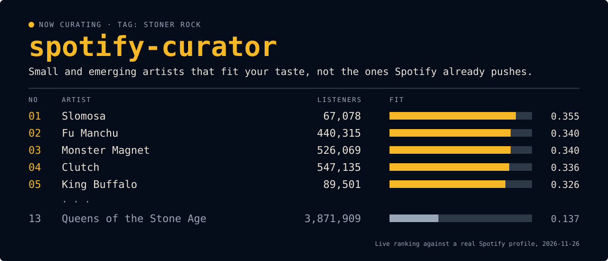
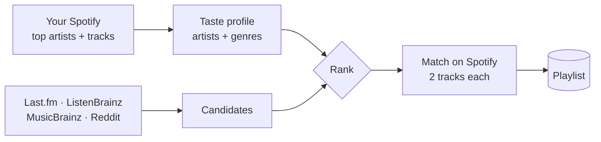
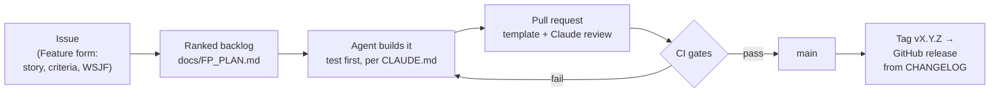

<p align="center">
  
</p>

<p align="center">
  <a href="https://github.com/petekaik/spotify-curator/actions/workflows/ci.yml"></a>
  <a href="https://github.com/petekaik/spotify-curator/actions/workflows/codeql.yml"></a>
  
  
  <a href="https://github.com/astral-sh/ruff"></a>
  <a href="CLAUDE.md"></a>
  <a href="LICENSE"></a>
</p>

Spotify recommends what already works, so the same popular artists keep coming back.
**spotify-curator** reads your Spotify listening history, looks for artists with a fraction of
that audience who still fit your taste, and writes them into a playlist.

It runs as a command-line tool, and as an agent skill inside Docker so another AI agent can ask
it for "this week's calming picks".

## How it works



1. **Profile.** Your top artists and tracks for the last 4 weeks, 6 months and all time are
   blended (50/30/20) into artist and genre weights. Spotify no longer returns artist genres, so
   genres come from each artist's top Last.fm tags.
2. **Discover.** Candidates come from Last.fm tag charts, enriched with listener counts and tags.
   ListenBrainz, MusicBrainz and Reddit clients exist and are tested, but not yet wired into
   playlist creation.
3. **Rank.** The score rewards genre overlap with your profile and a small audience
   (log-scaled Last.fm listeners), and penalises artists above 50,000 listeners.
4. **Build.** Each candidate is matched to a Spotify artist by exact name, two tracks are picked,
   and the playlist is shuffled so the same artist never plays twice in a row.

## Quick start

```bash
git clone https://github.com/petekaik/spotify-curator.git && cd spotify-curator
python3 -m pip install -e ".[dev]"
spotify-curator init          # writes .env: add your Spotify app and Last.fm keys
spotify-curator auth          # one-time OAuth in the browser
spotify-curator profile build
spotify-curator discover lastfm --tag "stoner rock"
spotify-curator playlist create "Fresh finds" --tag "stoner rock" --dry-run
```

Drop `--dry-run` to write a private playlist to your account. To run it as an agent skill, see
[deploy/README.md](deploy/README.md): OAuth runs once on the host, and the container reads the
token from a read-only mount.

## Drive it from any AI agent (MCP)

`spotify-curator-mcp` is a [Model Context Protocol](https://modelcontextprotocol.io) server, so
Claude, Codex, OpenClaw, Hermes or any MCP client can check status, preview and build playlists,
and **tune the ranking of a running deployment** ("fewer big names", "use post-rock for focus").
Tuning is saved in `$SPOTIFY_CURATOR_HOME/tuning.json` and applies to every later run.

| Tool | Does | Writes |
|---|---|---|
| `get_status` | Auth, profile age, Last.fm config | |
| `refresh_profile` | Rebuild the taste profile from Spotify | local profile |
| `discover` | Rank emerging artists for a Last.fm tag | |
| `create_mood_playlist` | One mood playlist; `dry_run` previews | Spotify |
| `create_weekly_playlists` | All six moods | Spotify |
| `get_reports` | Past runs and playlist URLs | |
| `get_tuning` / `update_tuning` | Read and change ranking settings and mood tags | local tuning |

Tools carry read-only and destructive hints, so clients can ask before anything writes to Spotify.

```bash
# Local, over stdio
claude mcp add spotify-curator -- spotify-curator-mcp
codex mcp add spotify-curator -- spotify-curator-mcp

# Deployed (docker compose service `mcp`, port 8788), over HTTP with a bearer token
claude mcp add --transport http spotify-curator http://<host>:8788/mcp \
  --header "Authorization: Bearer $SPOTIFY_CURATOR_MCP_TOKEN"
```

Any other client: command `spotify-curator-mcp` (stdio), or URL `http://<host>:8788/mcp` with
header `Authorization: Bearer <token>`. HTTP refuses to listen beyond localhost without
`SPOTIFY_CURATOR_MCP_TOKEN`; `GET /health` stays open for health checks.

<details>
<summary><b>Configuration</b></summary>

| Variable | Needed for | Default |
|---|---|---|
| `SPOTIPY_CLIENT_ID`, `SPOTIPY_CLIENT_SECRET` | Spotify ([create an app](https://developer.spotify.com/dashboard)) | none |
| `SPOTIPY_REDIRECT_URI` | Must match a redirect URI registered on the app | `http://127.0.0.1:43827/spotify/callback` |
| `LASTFM_API_KEY` | Discovery and genres ([get a key](https://www.last.fm/api/account/create)) | none |
| `SPOTIFY_CURATOR_HOME` | Profile, caches, token, reports | `~/.spotify-curator` |
| `SPOTIPY_CACHE_PATH` | Token file location (Docker mounts it read-only) | `$SPOTIFY_CURATOR_HOME/.cache` |
| `SPOTIPY_OPEN_BROWSER` | Set `false` on headless hosts | `true` |
| `SPOTIFY_CURATOR_MCP_TOKEN` | MCP over HTTP: bearer token clients must send | none (HTTP is then localhost-only) |
| `SPOTIFY_CURATOR_MCP_HOST`, `_PORT` | MCP over HTTP: bind address | `127.0.0.1`, `8788` |

</details>

## Status

Checked end to end against a real Spotify account on 2026-11-26.

| Area | State |
|---|---|
| CLI: profile → discover → rank → playlist | ✅ Works live: 30-track private playlist, 15 of 15 artists found on Spotify |
| Profile genres from Last.fm tags | ✅ Works live: 144 genres from 127 artists |
| Docker image with Hermes Agent skill (8 tools) | ✅ Builds and imports in CI · ⏳ not yet run against a live agent |
| ListenBrainz, MusicBrainz, Reddit sources | ✅ Unit-tested · ⏳ not used by `playlist create` yet |
| Track choice | ⚠️ Takes the newest release; Spotify's album lists carry no popularity ([FP_PLAN](docs/FP_PLAN.md#known-issues-code-review-2026-11-26)) |
| MCP server: 8 tools, stdio and HTTP, persistent tuning | ✅ Checked with a real MCP client over stdio and HTTP |
| Weekly digest daemon (FP-9) | 🚧 Scheduler and IPC done; the digest pipeline is a stub |
| Web UI (FP-8) | 📋 Planned |

## How it's built

Built with [Claude Code](https://claude.com/claude-code) as co-developer. The agent writes most of
the code, tests and docs. I set the architecture and backlog priorities, review every change,
run the live checks and decide what ships. The first build, from an empty repo to OAuth, profile,
four discovery sources, ranking, playlist builder, CLI and a Docker agent skill with 242 passing
tests, took one day (2026-07-08).



| Practice | How it runs here |
|---|---|
| **Requirements** | [Feature issue form](.github/ISSUE_TEMPLATE/feature.yml) with user story, testable acceptance criteria and WSJF score (business value ÷ time) → [FP backlog](docs/FP_PLAN.md) |
| **Design** | [Architecture](docs/ARCHITECTURE.md), design notes per FP; agent rules in [CLAUDE.md](CLAUDE.md) |
| **Development** | Test first; tests never call real APIs (mocks and [vcrpy](https://vcrpy.readthedocs.io) cassettes); `pre-commit` runs ruff and a secret scan |
| **QA** | [CI](.github/workflows/ci.yml): ruff lint and format, 246 tests on Python 3.12 and 3.13, coverage gate 80% (84% today), live end-to-end check before release |
| **Review** | [PR template](.github/PULL_REQUEST_TEMPLATE.md) records what the agent did and what a human decided; [Claude Code review](.github/workflows/claude.yml) on every PR, and `@claude` in an issue to delegate work |
| **Security** | [CodeQL](.github/workflows/codeql.yml) weekly and on PRs, [Dependabot](.github/dependabot.yml) for pip, Actions and the Docker base image, no secrets in git |
| **Ops** | Docker image built and smoke-tested in CI; headless OAuth via a host-side script; config through one module ([src/config.py](src/config.py)) |
| **Release** | [Keep a Changelog](CHANGELOG.md); pushing a `vX.Y.Z` tag publishes the notes as a [GitHub release](.github/workflows/release.yml) |

One example of the loop working: on 2026-11-26 an agent-run code review found that a test was
overwriting the real user profile with fixture data, and that the Docker container could never
find its Spotify token. Both were fixed the same day. The full list is in
the [changelog](CHANGELOG.md).

## Working with the February 2026 Spotify API

Spotify cut the Web API on 2026-02-06
([migration guide](https://developer.spotify.com/documentation/web-api/tutorials/february-2026-migration-guide)),
and spotipy 2.26 has not caught up. [`src/spotify/api_v2.py`](src/spotify/api_v2.py) calls the
new endpoints directly.

| Change | What this project does |
|---|---|
| `artist.popularity` and `artist.genres` gone | Popularity from Last.fm listener counts; genres from Last.fm top tags |
| `GET /artists/{id}/top-tracks` removed | Tracks taken from the artist's albums (see Status) |
| Search `limit` capped at 10 | Searches 5 results and keeps the exact name match |
| New `POST /playlists/{id}/items`, `PUT /me/library` | Used directly, with the JSON body sent as `payload=` |

## Repository layout

```
src/
  spotify/        OAuth and the Feb 2026 API wrapper
  analyzer/       taste profile, weights, Parquet cache
  discovery/      Last.fm, ListenBrainz, MusicBrainz, Reddit + ranking
  playlist/       resolve, pick tracks, shuffle, write
  cli/            Typer CLI
  hermes_skill/   the same pipeline as 8 agent tools
  mcp_server.py   the same tools over MCP (stdio and HTTP)
  daemon/         scheduler and IPC (digest is a stub)
  config.py       .env loading and DATA_DIR
skills/           Hermes skill definition and references
deploy/           Dockerfile, compose, host-side OAuth script
docs/             backlog, architecture, v0.2 plan
tests/            262 tests, fixtures and cassettes
```

## License

[MIT](LICENSE) © Petteri Kaikkonen · More projects at [gitpages.morgeweb.com](https://gitpages.morgeweb.com/)
